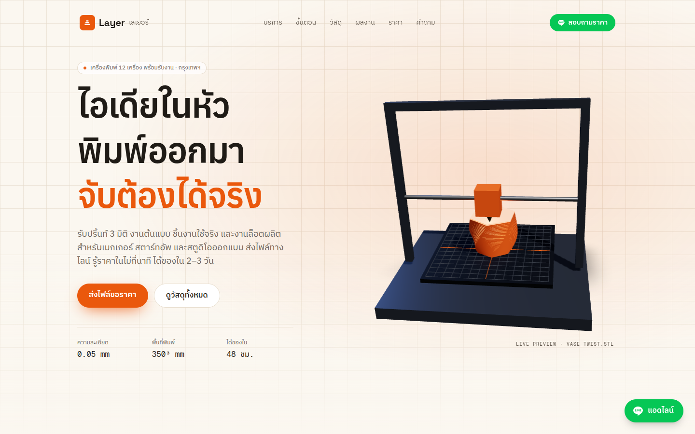
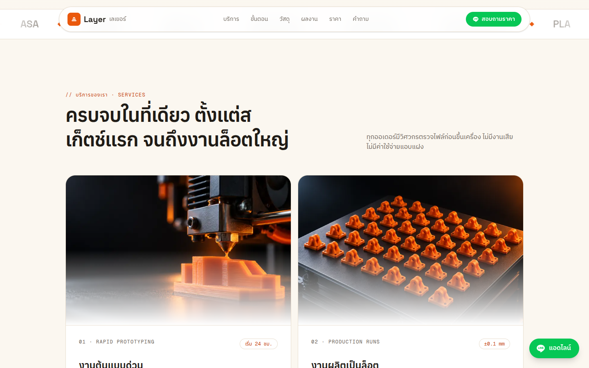
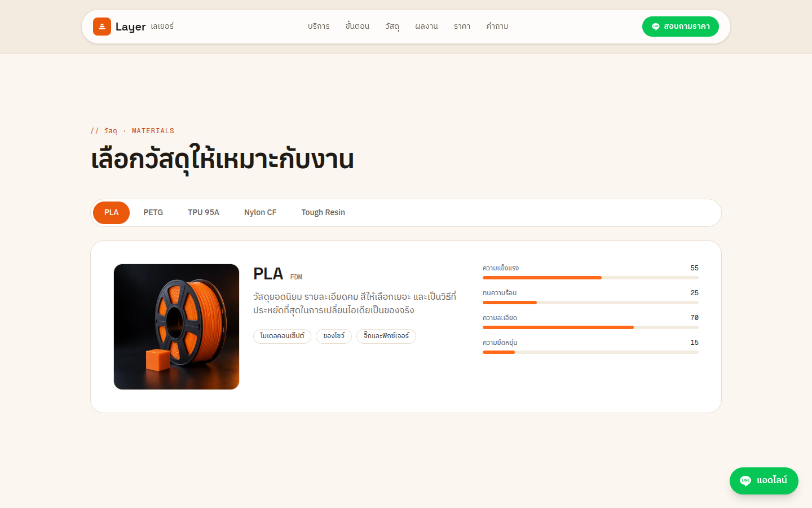
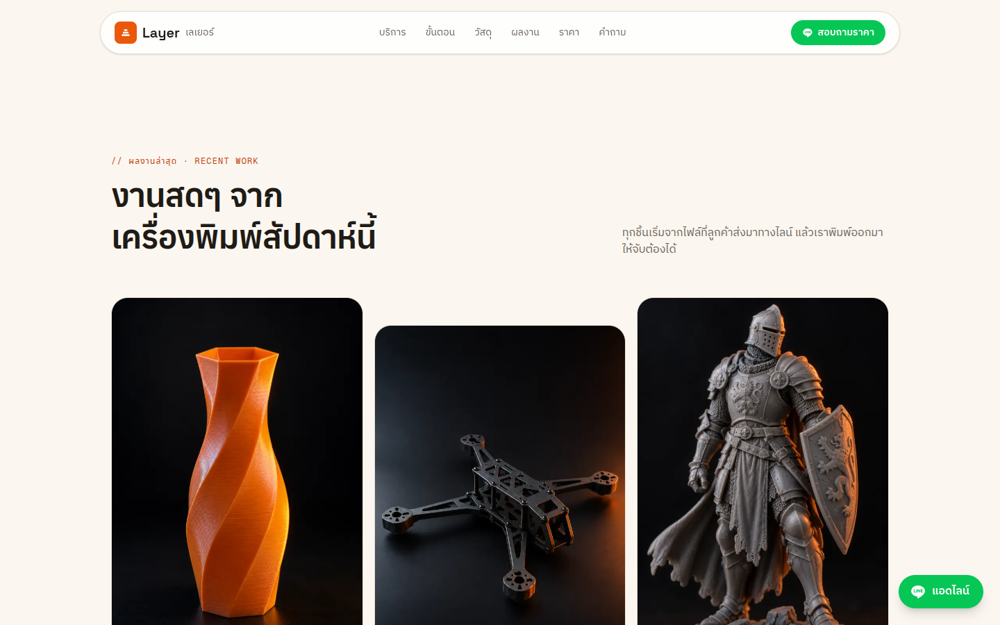
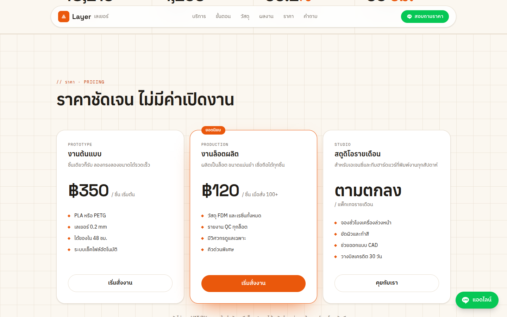
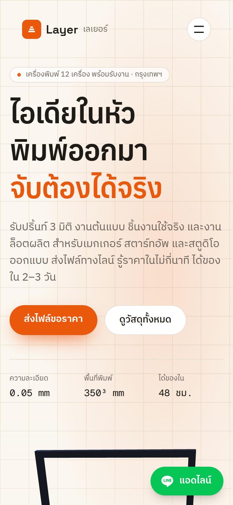

# Layer เลเยอร์ — 3D Printing Studio Landing Page

A Thai-language marketing site for **Layer**, a Bangkok 3D-printing studio offering rapid prototyping, production runs, and resin printing. The hero features a live, interactive Three.js printer scene, and the page is built around a "send your file on LINE, get a quote in minutes" flow.



## Screenshots

| Services | Materials |
| --- | --- |
|  |  |

| Recent work | Pricing |
| --- | --- |
|  |  |

<p align="center">
  
</p>

## Features

- **Interactive 3D hero** — a React Three Fiber printer scene, lazy-loaded client-side, paused while off-screen and respectful of `prefers-reduced-motion`.
- **Scroll-driven motion** — GSAP + ScrollTrigger for the hero timeline and parallax, Motion for section reveals and the material tab transitions.
- **Page sections** — Services, Process, Materials (PLA / PETG / TPU / Nylon CF / Tough Resin with spec bars), Gallery, Stats, Pricing, FAQ, and a quote CTA.
- **LINE-first contact** — a floating "แอดไลน์" button and LINE-branded CTAs, as is standard for Thai SMEs.
- **Thai typography** — IBM Plex Sans Thai for body text, Space Grotesk + Anuphan for display, Geist Mono for specs, all via `next/font`.
- **SEO / social** — Thai metadata, Open Graph and Twitter card image (`public/images/og/og.jpg`).

## Tech Stack

| Area | Tools |
| --- | --- |
| Framework | Next.js 16 (App Router, `cacheComponents`), React 19, TypeScript |
| Styling | Tailwind CSS v4 (design tokens in `src/app/globals.css`) |
| 3D | three, @react-three/fiber, @react-three/drei |
| Animation | GSAP, @gsap/react, Motion |
| Tooling | pnpm, ESLint (`eslint-config-next`) |

## Getting Started

Requires Node.js 20+ and pnpm.

```bash
pnpm install
pnpm dev
```

Open [http://localhost:3000](http://localhost:3000).

### Scripts

| Command | Description |
| --- | --- |
| `pnpm dev` | Start the development server |
| `pnpm build` | Create a production build |
| `pnpm start` | Serve the production build |
| `pnpm lint` | Run ESLint |

### Environment

| Variable | Purpose | Default |
| --- | --- | --- |
| `NEXT_PUBLIC_SITE_URL` | Base URL used for Open Graph / metadata links | `http://localhost:3000` |

## Project Structure

```
src/
├── app/
│   ├── layout.tsx        # Fonts, metadata, floating LINE button
│   ├── page.tsx          # Section composition
│   └── globals.css       # Tailwind v4 theme tokens (ink, filament, line-green…)
├── components/
│   ├── Nav.tsx  Hero.tsx  Marquee.tsx  Services.tsx  Process.tsx
│   ├── Materials.tsx  Gallery.tsx  Stats.tsx  Pricing.tsx  Faq.tsx
│   ├── Cta.tsx  Footer.tsx  LineButton.tsx
│   └── three/
│       ├── HeroCanvas.tsx    # Lazy loader + visibility/reduced-motion handling
│       └── PrinterScene.tsx  # The R3F printer scene
└── lib/
    └── gsap.ts           # Registers ScrollTrigger and useGSAP once
public/images/            # Gallery, materials, services and OG imagery
docs/screenshots/         # README screenshots
```

## Editing Content

Page copy lives directly in each component as typed arrays — e.g. pricing tiers in `src/components/Pricing.tsx` and material specs in `src/components/Materials.tsx`. Update those arrays to change prices, materials, or text.

## Deployment

The site prerenders as static content and deploys to any Next.js host (e.g. Vercel). Set `NEXT_PUBLIC_SITE_URL` to the production domain so social previews resolve correctly.
